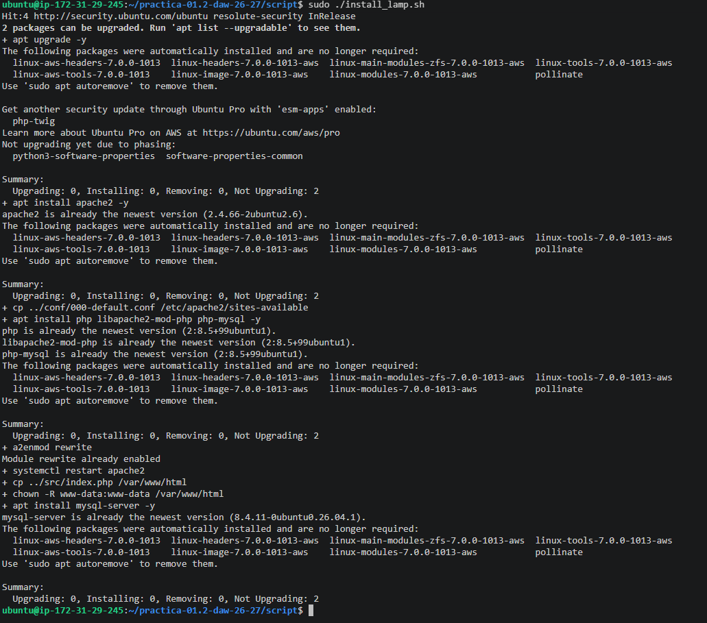
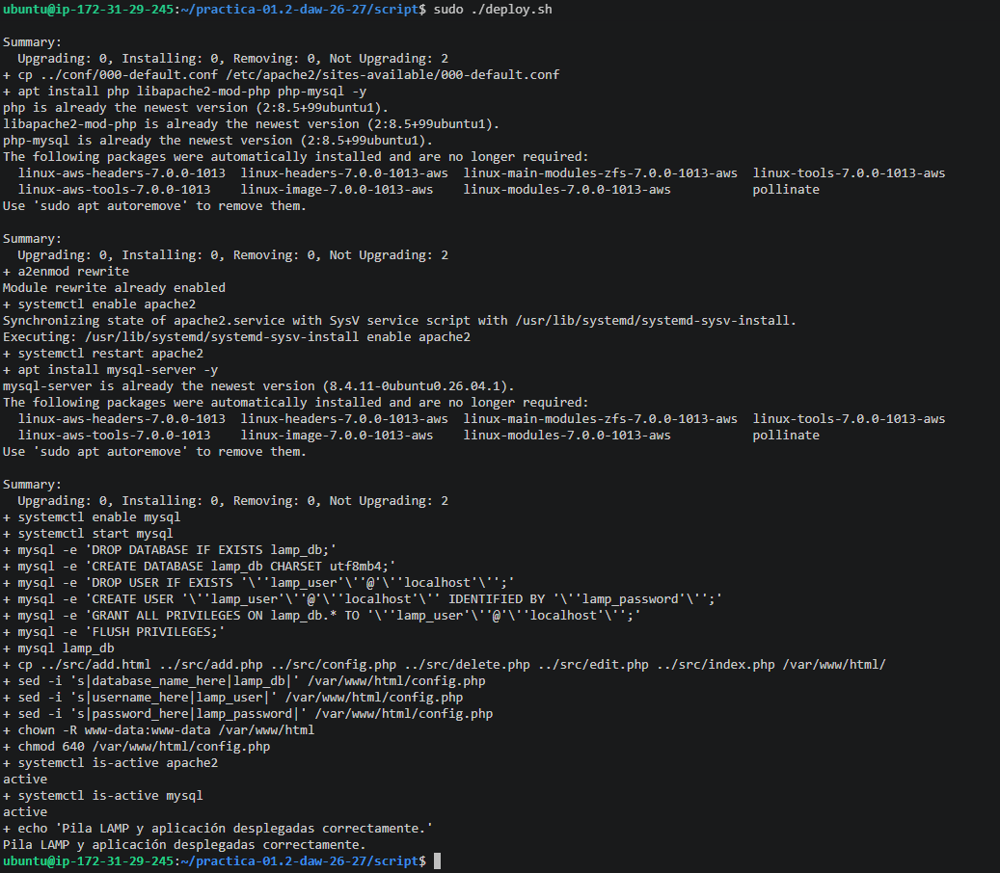

# practica-01.2-daw-26-27

---

## 1. Instalación de la Pila LAMP

Para comenzar, nos conectamos a la instancia de Ubuntu Server y actualizamos los repositorios del sistema. Luego, procedemos a instalar los paquetes básicos de la pila LAMP.

**Comandos ejecutados:**

### Actualizamos los repositorios del sistema.
```bash
sudo apt update 
sudo apt upgrade -y
```
### Instalamos el servidor web Apache
```bash
apt install apache2 -y
```
### Copiamos nuestro archivo de configuración de VirtualHost
```bash
cp ../conf/000-default.conf /etc/apache2/sites-available
```
### Instalamos los paquetes necesarios para tener PHP
```bash
apt install php libapache2-mod-php php-mysql -y

```
### Habilitamos el módulo rewrite de Apache
```bash
a2enmod rewrite

```
### Reiniciamos el servicio de Apache
```bash
systemctl restart apache2

```
### Copiar el archivo php/index.php a /var/www/html
```bash
cp ../php/index.php /var/www/html

```
### Modificamos el propietario del diretoro /var/www/html
```bash
chown -R www-data:www-data /var/www/html

```
### Instalamos MySQL Server
```bash
apt install mysql-server -y
```




---

## 2. Despliegue de la aplicación

Una vez instalada la pila LAMP, automatizamos el despliegue completo con el script `deploy.sh`. Además de instalar Apache, PHP y MySQL, este script crea la base de datos y el usuario, importa la tabla `users`, copia la aplicación PHP a `/var/www/html` y configura sus credenciales.

**Comandos ejecutados:**

### Cargamos las variables de configuración desde el archivo .env
```bash
source .env
```
### Habilitamos MySQL en el arranque y nos aseguramos de que está activo
```bash
systemctl enable mysql
systemctl start mysql
```
### Recreamos la base de datos y el usuario (así el script se puede repetir)
```bash
mysql -e "DROP DATABASE IF EXISTS ${DB_NAME};"
mysql -e "CREATE DATABASE ${DB_NAME} CHARSET utf8mb4;"
mysql -e "DROP USER IF EXISTS '${DB_USER}'@'localhost';"
mysql -e "CREATE USER '${DB_USER}'@'localhost' IDENTIFIED BY '${DB_PASSWORD}';"
mysql -e "GRANT ALL PRIVILEGES ON ${DB_NAME}.* TO '${DB_USER}'@'localhost';"
mysql -e "FLUSH PRIVILEGES;"
```
### Importamos la estructura de la base de datos (tabla users)
```bash
mysql "${DB_NAME}" < ../db/database.sql
```
### Copiamos todos los archivos de la aplicación a /var/www/html
```bash
cp ../src/* /var/www/html/
```
### Configuramos las credenciales de la base de datos en config.php
```bash
sed -i "s|database_name_here|${DB_NAME}|" /var/www/html/config.php
sed -i "s|username_here|${DB_USER}|" /var/www/html/config.php
sed -i "s|password_here|${DB_PASSWORD}|" /var/www/html/config.php
```
### Modificamos el propietario del directorio /var/www/html
```bash
chown -R www-data:www-data /var/www/html
```
### Restringimos los permisos de config.php, que contiene la contraseña
```bash
chmod 640 /var/www/html/config.php
```
### Comprobamos que los servicios están activos
```bash
systemctl is-active apache2
systemctl is-active mysql
```
### Ejecutamos el script
```bash
chmod +x deploy.sh
sudo ./deploy.sh
```




---